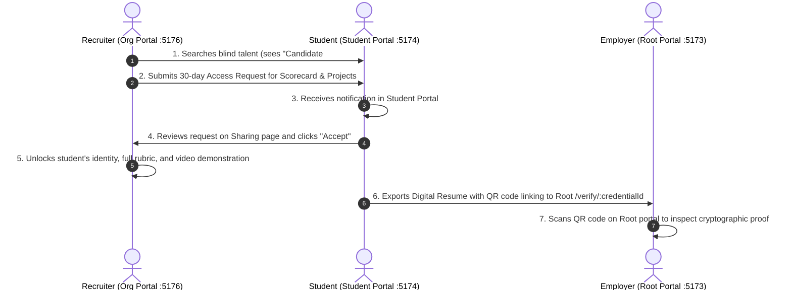

# AptoHire Master Implementation & AI Tool Execution Guide

> **Target Audience:** You and your IDE AI Tool (Cursor, Claude Code, Windsurf, GitHub Copilot).
> **Purpose:** Step-by-step master guide to build, connect, and deploy the entire 5-portal + 1-backend AptoHire platform.
> **Source Documents Referenced:** `uploads/MASTER-RUNBOOK.md`, `uploads/prd.md`, `uploads/features.md`, `uploads/architecture.md`, `uploads/Security.md`, `uploads/agent.md`.

---

## 1. What Is Completed vs. What Is Left

AptoHire consists of **five separate frontend portals + one shared backend**:

```text
aptohire/                                 ← Master Parent Directory
├── aptohire-backend/                     ← Shared Database, RLS, Edge Functions, Contracts
├── aptohire-root/         (Port 5173)    ← Marketing landing, public /verify/:id, applications
├── aptohire-student/      (Port 5174)    ← [COMPLETED IN THIS WORKSPACE] Verified student portal
├── aptohire-university/   (Port 5175)    ← TPO placement office, roster matching, talent funnel
├── aptohire-organization/ (Port 5176)    ← Recruiter portal, blind talent discovery, access requests
└── aptohire-admin/        (Port 5177)    ← Admin approvals, blind appeals, kill switch, MFA
```

### Current Status Matrix

| Component | Status | Details |
|---|---|---|
| **`aptohire-student`** | **100% Complete** | 21 complete views, living skill graph, proof rings, multi-modal submission engine, 3-tier session cookies, cross-persona resolution, appeal tickets, PDF resume generator. 50/50 Playwright E2E tests passing. |
| **`aptohire-backend`** | **Foundation Ready (~50%)** | Express API server, Supabase schema migrations (profiles, affiliations, submissions, audits, RLS), 5 Edge Function contracts. Needs delta audit and full contract export. |
| **`aptohire-root`** | **To Be Built** | Public landing page, marketing hero, public `/verify/:credentialId` certificate viewer, university application form, organization request form. |
| **`aptohire-university`** | **To Be Built** | Placement director dashboard, cohort skill distribution, CSV roster upload & hash matching, unmatched employer demand analysis. |
| **`aptohire-organization`** | **To Be Built** | Blind candidate discovery (no names, no photos, no emails), skill matching matrix, access request management (7/30/90 days), unlocked profiles. |
| **`aptohire-admin`** | **To Be Built** | University accreditation approvals, blind reviewer audit appeals, AI Kill Switch, mandatory TOTP MFA. |

---

## 2. Step-by-Step Prompting Strategy for Your IDE AI Tool

Do not paste massive prompts all at once into your AI tool. AI models degrade in quality when overwhelmed with 30-page prompts. Use the **Phased Chunking Strategy**:

### Step 2.1: The AI Tool Golden Rule
When starting any folder in your IDE AI tool (Cursor / Claude Code):
1. **Create the target folder** (e.g. `aptohire-university/`).
2. Run `git init`.
3. Provide the prompt for that folder and explicitly instruct:
   > *"Read `uploads/MASTER-RUNBOOK.md`, `uploads/architecture.md`, and the prompt below. Implement **Phases 1 to 3 only**. Stop and run typecheck/tests before proceeding. Do not build later phases yet."*
4. Test the generated code:
   ```bash
   npm run typecheck && npm test && npm run build
   ```
5. Commit to Git:
   ```bash
   git add -A && git commit -m "feat: complete phases 1 to 3"
   ```
6. Prompt the next phase:
   > *"Read `docs/PLAN.md` and the existing code. Continue with **Phases 4 to 6**. Do not rewrite existing working components."*

---

## 3. How to Connect the Student Portal to the Backend

The student portal in this workspace is currently running in **Mock Mode** (`VITE_USE_MOCKS=true`), which allows it to run 100% standalone with instant in-memory cookies and seed data.

### Step 3.1: Start Local Supabase
1. Make sure **Docker Desktop** is running on your machine.
2. In your terminal inside `aptohire-backend/`:
   ```bash
   # Start local Supabase containers (PostgreSQL, Auth, Storage, Edge Functions)
   npm run db:start

   # Apply all migrations and seed data
   npm run db:reset

   # Run Edge Functions in a persistent terminal
   npm run fn:serve
   ```
3. Run `npx supabase status`. You will see output like this:
   ```text
   API URL: http://127.0.0.1:54321
   anon key: eyJhbGciOiJIUzI1NiIsInR5cCI6IkpXVCJ9...
   service_role key: [KEEP PRIVATE - NEVER PUT IN FRONTEND]
   Inbucket URL: http://127.0.0.1:54324 (local email catcher)
   ```

### Step 3.2: Switch `aptohire-student` to Real Backend Mode
In `aptohire-student/`, create a file named `.env.local` (this file is ignored by `.gitignore` so your secrets are safe):

```env
# 1. Disable mock mode and connect to real Supabase
VITE_USE_MOCKS=false
VITE_DEMO_MODE=true

# 2. Supabase connection details (from supabase status)
VITE_SUPABASE_URL=http://127.0.0.1:54321
VITE_SUPABASE_ANON_KEY=your-anon-key-from-supabase-status

# 3. Local URLs for cross-portal navigation
VITE_SITE_URL=http://localhost:5174
VITE_ROOT_URL=http://localhost:5173
VITE_UNIVERSITY_URL=http://localhost:5175
VITE_ORGANIZATION_URL=http://localhost:5176

# 4. Auth & Video Limits
VITE_DEMO_PASSWORD=demo-password-fictional
VITE_VIDEO_MAX_MB=50
VITE_VIDEO_MAX_SECONDS=190
```

Restart the dev server:
```bash
npm run dev
```
The student portal is now communicating with real PostgreSQL database tables and Edge Functions!

---

## 4. How Cross-Portal Connectivity Works

Every portal runs on its own dedicated port locally and on its own subdomain in production:

| Portal | Local Port | Production Subdomain | Target User |
|---|---|---|---|
| **Root** | `http://localhost:5173` | `https://aptohire.com` | Public, Applicants, Certificate Verifiers |
| **Student** | `http://localhost:5174` | `https://student.aptohire.com` | Students & Job Seekers |
| **University** | `http://localhost:5175` | `https://university.aptohire.com` | TPO Directors, Career Services |
| **Organization** | `http://localhost:5176` | `https://organization.aptohire.com` | Technical Recruiters, Hiring Managers |
| **Admin** | `http://localhost:5177` | `https://admin.aptohire.com` | Superadmins & Reviewers (MFA Required) |

### 4.1 Automatic Role Guard & Cross-Portal Redirection
In `frontend/src/app/RoleGuard.tsx`:
- When a user logs in, their JWT token contains their `role` (`student`, `university`, `organization`, or `admin`).
- If an **organization recruiter** signs in at the **student portal**, `RoleGuard.tsx` detects the role mismatch and renders:
  > *"You are signed in as an Organization Recruiter. Go to Organization Portal &rarr;"*
- The button links to `portalUrl('organization')` (`http://localhost:5176` or `https://organization.aptohire.com`).

### 4.2 Cross-Portal Data Flows



---

## 5. Master Execution Order for Your Remaining AI Tool Prompts

Follow this sequence to build the rest of the ecosystem cleanly:

### Phase 1: Complete and Export Backend Contracts (`aptohire-backend/`)
1. Open `aptohire-backend/` in VS Code.
2. Give your AI tool `00b-aptohire-backend-delta-prompt.md`.
3. Verify RLS policies:
   ```bash
   npm run db:test && npm run fn:test
   ```
4. Export the database contract:
   ```bash
   npm run contract:export
   ```
   This generates `contract-dist/CONTRACT.md`, defining exact SQL view names, RPC functions, and table columns.
5. Copy `CONTRACT.md` into the `docs/` folder of all frontend portals.

### Phase 2: Build Marketing Root Site (`aptohire-root/`)
1. Create `aptohire-root/` and initialize with `01-aptohire-root-prompt.md`.
2. Port: **5173**.
3. Key views to verify:
   - High-impact Hero landing page with proof pitch.
   - Portal chooser cards ("I am a Student / University / Organization").
   - Public Certificate verification view at `/verify/:credentialId`.
   - "Apply for university access" form (creates pending Uni C record).

### Phase 3: Build University Portal (`aptohire-university/`)
1. Create `aptohire-university/` and initialize with `03-aptohire-university-prompt.md`.
2. Port: **5175**.
3. Key views to verify:
   - Placement Director / TPO Overview: skill distribution bar charts and talent readiness funnel.
   - Roster Management: CSV drag-and-drop upload, hashing student IDs against rosters.
   - **Unmatched Employer Demand**: Shows anonymized market skill demand counts without disclosing student identities.

### Phase 4: Build Organization Recruiter Portal (`aptohire-organization/`)
1. Create `aptohire-organization/` and initialize with `04-aptohire-organization-prompt.md`.
2. Port: **5176**.
3. Key views to verify:
   - **Blind Talent Discovery**: Candidate cards display only Aliases, Verified Proof Rings, and Match Keywords. **Zero PII (no names, photos, emails, or university names).**
   - Access Request Modal: Configure duration (7, 30, 90 days) and scopes (`profile`, `scorecard`, `projects`).
   - Unlocked Candidate Profile: View full evidence trail once student approves.

### Phase 5: Build Admin Portal (`aptohire-admin/`)
1. Create `aptohire-admin/` and initialize with `05-aptohire-admin-prompt.md`.
2. Port: **5177**.
3. Key views to verify:
   - **MFA Enforcement**: Enrolls TOTP 6-digit authenticator app upon first login.
   - University Approvals: Approve/reject pending university accreditation applications (e.g. Uni C).
   - Blind Dispute Review: Different reviewer re-grades disputed submissions.
   - **AI Kill Switch**: Banner and toggle that switches automated reviews to human-only queue.

---

## 6. How to Run All Six Projects Simultaneously

Save this script as `start-all.sh` (or `start-all.ps1` on Windows) in the parent `aptohire/` directory:

### macOS / Linux (`start-all.sh`)
```bash
#!/usr/bin/env bash
# Start Supabase Edge Functions + All 5 Portals
npx concurrently --kill-others -n "BACKEND,ROOT,STUDENT,UNI,ORG,ADMIN" \
  -c "bgBlue,bgMagenta,bgGreen,bgYellow,bgCyan,bgRed" \
  "cd aptohire-backend && npm run fn:serve" \
  "cd aptohire-root && npm run dev" \
  "cd aptohire-student && npm run dev" \
  "cd aptohire-university && npm run dev" \
  "cd aptohire-organization && npm run dev" \
  "cd aptohire-admin && npm run dev"
```

---

## 7. How to Make It Production Ready

### 7.1 Database & Security Hardening
Before launching to production:
1. **Never commit `.env` or `.env.local` files.** Keep only `.env.example`.
2. **Never expose the `service_role` key.** Only the `anon` key is placed in frontend environment variables.
3. **Execute the Security Audit (`uploads/Security.md`)**:
   - Verify every table has `ALTER TABLE ... ENABLE ROW LEVEL SECURITY;`.
   - Verify all Storage buckets (`videos`, `documents`, `resumes`) require signed URLs and are not public.
   - Ensure the Admin account has mandatory TOTP MFA enrolled.

### 7.2 Production Supabase Setup
1. Create a free project on [supabase.com](https://supabase.com).
2. Link your local CLI to the cloud project:
   ```bash
   cd aptohire-backend
   npx supabase login
   npx supabase link --project-ref your-cloud-project-ref
   npx supabase db push
   ```
3. Set your production function secrets:
   ```bash
   npx supabase secrets set --env-file .env.production.local
   npx supabase functions deploy
   ```

### 7.3 Multi-Project Vercel Deployment
Deploy each of the 5 portals as an independent project on Vercel:
1. In Vercel, click **Add New > Project** and select your repository.
2. Configure 5 separate Vercel projects:
   - `aptohire-root` &rarr; Domain: `aptohire.com` (and `www.aptohire.com`)
   - `aptohire-student` &rarr; Domain: `student.aptohire.com`
   - `aptohire-university` &rarr; Domain: `university.aptohire.com`
   - `aptohire-organization` &rarr; Domain: `organization.aptohire.com`
   - `aptohire-admin` &rarr; Domain: `admin.aptohire.com`
3. Set Environment Variables in each Vercel project:
   ```env
   VITE_APP_ENV=production
   VITE_USE_MOCKS=false
   VITE_DEMO_MODE=false
   VITE_SUPABASE_URL=https://your-project.supabase.co
   VITE_SUPABASE_ANON_KEY=your-production-anon-key
   ```
4. All 5 portals will build with zero errors thanks to our verified chunk-splitting and SPA rewrites.

---

## 8. Definition of Done Checklist

- [ ] **Student Portal (`aptohire-student`)**: 50/50 Playwright E2E tests pass, 30-day session cookies active, verified scorecard links resolve seamlessly.
- [ ] **Backend (`aptohire-backend`)**: `npm run db:reset`, `npm run db:test`, and `npm run fn:test` pass cleanly.
- [ ] **Root (`aptohire-root`)**: Public landing page loads, and `/verify/:credentialId` displays verified skills.
- [ ] **University (`aptohire-university`)**: Placement funnel and CSV roster matching operational.
- [ ] **Organization (`aptohire-organization`)**: Blind candidate discovery contains **zero** PII before access is granted.
- [ ] **Admin (`aptohire-admin`)**: Approvals workflow, dispute appeals, and TOTP MFA active.
- [ ] **7-Minute End-to-End Demo Script** (Section 8 of Master Runbook) completes successfully across all portals.
